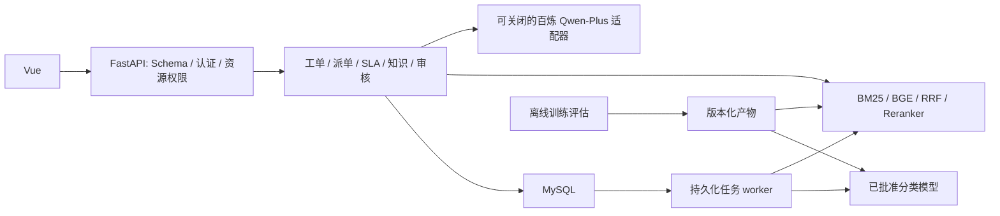

# SmartTicket AI：已确认架构与实施边界

最初确认日期2026-11-06，当前实现更新至2026-11-09。阶段A为可运行参考项目，当前35表/0003_reviews。整体运行和验收入口见21-整体交付与运行手册.md，历史环境快照不作为当前状态。

## 业务与边界

虚构 3C 电商的售后工单平台。业务记录、政策和初始样例均为模拟，不能称为真实企业数据。采用模块化单体：Vue 客户端 → FastAPI → 业务服务 → MySQL；独立 worker 执行持久化任务。训练、评估和在线推理解耦。

工单创建先提交数据库，随后分析和派单；分类失败保留工单并进入人工队列。业务状态与分析状态分离。规则提取订单号候选，授权查询确认事实，LLM 不能确认订单是否存在。所有 AI 回复先是待审核草稿，审核和发送分别发生；发送前重新校验工单、权限及知识版本。

## 模块依赖

API 不在导入或启动时训练、下载模型、迁移数据库或生成数据；不把 GPU 推理直接放入异步事件循环。数据库事务不得跨越外部 LLM 调用。初始不增加 Redis、Celery、微服务或多智能体。

## 关键决策

- 分类标签固定六类；主类别、诉求、原因和多诉求标记分别表达。无法确定则人工复核。
- RF、fastText、BERT 共用数据和测试集，按实验选择线上模型，不预设 BERT 获胜。
- RF 之外增加低成本 Logistic Regression 对照。
- 知识审核、版本、有效期与索引来源属于 P0；通知升级可在 P1。
- BM25、纯向量、混合、混合加重排分别实测。无证据时拒答。
- SLA 使用自然小时，等待客户/第三方不停表；自动回执、内部备注、草稿不计首次响应。
- 重开建立新 SLA 周期，不清除历史超时。解决/关闭后七日内允许重开为暂定业务政策。
- 修改使用版本校验；派单锁定工单、客服容量并在事务内记录事件。
- 任务至少一次执行，靠业务幂等抵御重复；不宣称恰好一次。
- 客户只能读自己的公开数据；客服只能处理当前指派且业务权限允许的数据。
- 新安装和Docker默认关闭LLM；本机按后续明确授权启用百炼qwen-plus，总预算60。所有真实调用先持久化预留，模型不持有业务修改或SQL工具。

## 环境与版本管理

新环境使用项目内 `.conda`，不修改原课程 `toumanfen`、`ml`。原目录 `E:\AI_project\first_project` 只读保留。安装依赖只发生在新环境。先解析、安装、执行 smoke 与 `pip check`，再输出锁定清单；未做实际验证的 GPU/模型组合不能记为兼容。

2026-11-06启动前快照：Windows 11、约16GB RAM、RTX3060 Laptop 6GB、驱动552.22、WSL2.7.12；当时Docker不可连接、原MySQL未查询。后续已在新项目33307实例和独立Compose实测，原MySQL80不改动；以最终验收报告为准。

fastText 官方仓库归档，优先隔离 Linux CPU 实验；FAISS 使用 CPU。BERT 初始从 length=128、小 batch、梯度累积开始测量，不承诺显存或训练时长。

## 实施阶段

1. 工程基础、独立环境、标签与数据规范、分类流程 smoke。
2. 人工审核的数据试点，正式模型实验（含 fastText、BERT）。
3. MySQL 业务模型、迁移审查、认证、工单、派单与受控业务查询。
4. 知识导入、发布、有效性与四组检索评测。
5. 草稿、事实和证据校验、审核反馈。
6. 基础 Vue 前端联调。
7. SLA 通知、恢复、指标、Docker 与端到端验收。
8. 面试材料和隔离的独立复刻。

数据库迁移执行前检查目标库及生成 SQL，不连接或修改用户原有库。所有未完成项见 `docs/实施进度.md`。

## 官方依据

- https://fastapi.tiangolo.com/tutorial/
- https://docs.sqlalchemy.org/en/20/orm/versioning.html
- https://dev.mysql.com/doc/refman/8.4/en/innodb-locking-reads.html
- https://github.com/facebookresearch/fastText
- https://github.com/facebookresearch/faiss/blob/main/INSTALL.md
- https://huggingface.co/google-bert/bert-base-chinese
- https://huggingface.co/BAAI/bge-small-zh-v1.5
- https://huggingface.co/BAAI/bge-reranker-base
- https://help.aliyun.com/zh/model-studio/compatibility-of-openai-with-dashscope
- https://help.aliyun.com/zh/model-studio/qwen-structured-output

模型卡可访问、许可证可读不代表权重已经下载或本机加载成功。
