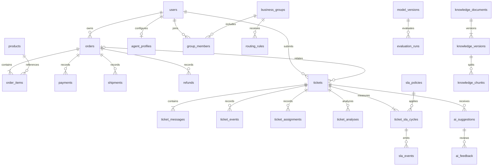

# 数据库设计与实现版本

当前实现已迁移到0003_reviews，本机业务库、隔离测试库与Compose库均为34业务表加版本表，共35表。以backend/app/db/models.py、静态Alembic和docs/sql/05-full-schema-current.sql为准。原MySQL80/3306未改动。下方v0.1是编码前的设计快照，部分目标表后来合并或改名，不等同于实际schema。

新增审核关系：users→review_collections（来源导入人），review_collections→review_items（不可覆盖来源内容），review_items→review_decisions（追加式判定），review_collections→review_snapshots（绑定审核ID和来源指纹的不可变行集），review_snapshots→model_releases（版本化审批与独立发布包）。完整流程见20-数据复核与模型审批.md。

## v0.1历史设计

第三批落地补充：当前 `db/models.py` 实现其中核心业务部分，共21表；AI/知识/评测/SLA通知表尚未建模迁移。新增 dispatch_mutex（容量变更全局单行锁）和 admin_events（非工单管理审计）。已生成静态 Alembic 0001_core 和离线 SQL，尚未向 MySQL 执行。当前审查包见 docs/sql/README.md，测试范围见第三批记录。

本文件记录编码前的目标设计，不代表数据库已经建立。MySQL 专用新库，SQLAlchemy 2.x + Alembic；本阶段不连接原有 MySQL。

## ER

## 类型、主外键与约束

除关联/扩展表外使用 `id BIGINT` 主键；API 将 ID 序列化为字符串。创建/更新时间为 UTC 约定的 `DATETIME(6)`。关键外键默认限制删除。金额 `DECIMAL(12,2)`；状态有限值校验；可修改实体包含非空 `version INT`。以下 `*_id` 除特别说明外为对应实体外键。

| 表 | 关键字段 | 主要约束/索引 |
|---|---|---|
| users | login VARCHAR(100), password_hash VARCHAR(255), role VARCHAR(16), enabled BOOLEAN, auth_version INT | login UNIQUE |
| agent_profiles | user_id BIGINT PK/FK, online BOOLEAN, capacity INT, active_load INT, last_assigned_at | 负载/容量非负 |
| business_groups | code VARCHAR(50), name VARCHAR(100), enabled BOOLEAN | code UNIQUE |
| group_members | group_id, user_id, permission_scope JSON | UNIQUE(group_id,user_id) |
| routing_rules | category SMALLINT, group_id, rank INT, enabled BOOLEAN, version INT | INDEX(category,enabled,rank) |
| products | sku VARCHAR(64), name VARCHAR(200) | sku UNIQUE |
| orders | order_no VARCHAR(64), customer_id, status VARCHAR(32), total_amount | order_no UNIQUE; INDEX(customer_id,created_at) |
| order_items | order_id, product_id, line_no INT, quantity INT, unit_price, product_name_snapshot | UNIQUE(order_id,line_no); quantity>0 |
| payments | order_id, record_no VARCHAR(64), amount, status, occurred_at | record_no UNIQUE; INDEX(order_id) |
| shipments | order_id, tracking_no VARCHAR(100), carrier VARCHAR(50), status | INDEX(order_id) |
| refunds | order_id, record_no VARCHAR(64), amount, status, reason TEXT | record_no UNIQUE |
| tickets | ticket_no VARCHAR(64), customer_id, order_id NULL, subject VARCHAR(200), category SMALLINT NULL, priority/status, assignee_id NULL, version | ticket_no UNIQUE; 客户/客服/队列复合索引 |
| ticket_messages | ticket_id, author_id, visibility VARCHAR(16), body TEXT, suggestion_id NULL | INDEX(ticket_id,id) |
| ticket_events | ticket_id, actor_id NULL, event_type, old/new JSON, reason TEXT, request_id VARCHAR(64) | INDEX(ticket_id,id); 应用角色只追加 |
| ticket_assignments | ticket_id, agent_id, group_id, started_at, ended_at NULL, reason, rule_version | 活跃 ticket_id 生成列 UNIQUE |
| ticket_analyses | ticket_id, input_version INT, model_version_id, category, scores/entities JSON, status | UNIQUE(ticket_id,input_version,model_version_id) |
| sla_policies | policy_code, version INT, priority, response_seconds INT, resolution_seconds INT, warning_seconds INT | UNIQUE(policy_code,version,priority); 正时长 |
| ticket_sla_cycles | ticket_id, cycle_no INT, policy_id, policy_snapshot JSON, started_at, response_due_at, resolution_due_at, first_response_at NULL, resolved_at NULL | UNIQUE(ticket_id,cycle_no); 两个 due_at 分别索引 |
| sla_events | cycle_id, event_type, created_at | UNIQUE(cycle_id,event_type) |
| knowledge_documents | document_key VARCHAR(100), title, business_scope | document_key UNIQUE |
| knowledge_versions | document_id, version_no INT, content LONGTEXT, content_hash CHAR(64), status, effective_from/to, reviewer_id, reviewed_at, published_at | UNIQUE(document_id,version_no); 有效期索引 |
| knowledge_chunks | version_id, chunk_no INT, text TEXT, content_hash CHAR(64), section_path, token_count INT | UNIQUE(version_id,chunk_no) |
| index_generations | generation_no VARCHAR(64), manifest_path, manifest_hash CHAR(64), model_revision, status, activated_at | generation_no UNIQUE |
| ai_suggestions | ticket_id, input_version, model/prompt/index 版本, draft TEXT, citations/facts/risk JSON, status, usage JSON, latency_ms | INDEX(ticket_id,created_at) |
| ai_feedback | suggestion_id, reviewer_id, action, final_text TEXT, reason TEXT, review_status | 最终处理结果唯一约束；修改保留版本 |
| model_versions | task/name/revision, artifact_path, hash CHAR(64), label_map_hash CHAR(64), status | 任务+版本唯一 |
| evaluation_runs | task, model_version_id, dataset_hash CHAR(64), config/metrics JSON, report_path, started_at | 指向真实产物 |
| job_tasks | type, dedupe_key VARCHAR(160), payload JSON, status, attempts INT, available_at, lease_until, last_error TEXT | dedupe_key UNIQUE; INDEX(status,available_at,id) |
| idempotency_keys | actor_id, operation, key VARCHAR(128), request_hash CHAR(64), response_snapshot JSON, expires_at | UNIQUE(actor_id,operation,key) |

工单索引：`(customer_id,created_at,id)`、`(assignee_id,status,created_at)`、`(status,priority,created_at,id)`。优先级排序使用明确的数值 rank，不能依赖字符串顺序。

## 并发与不变量

- UPDATE 带 expected_version，影响行数为零返回冲突；不能依赖未经校验的批量 ORM UPDATE。
- 现行派单先锁dispatch_mutex，再锁工单并重查候选负载；旧指派结束、新负载、工单与事件同事务。全部29张业务表与外键对照见数据库实现对照.md。
- 一个工单仅一个有效指派；MySQL 用条件生成列（未结束返回 ticket_id，否则 NULL）+ UNIQUE。
- 工单关联订单必须属于创建客户；客服查询须有当前授权工单上下文。
- 消息变化递增输入版本；发送草稿重新检查该版本和知识状态。
- SLA 重开新增 cycle，不改写旧周期。超时事件按 cycle/type 唯一。
- 工单和初始任务同事务；worker 用可恢复租约，业务幂等承担重复执行。

## 迁移、生命周期与脱敏

先生成 Alembic SQL 并审查；执行前明确新库、备份和授权。不使用启动自动迁移、不执行删除原有库/表。MySQL 并发集成测试使用隔离测试实例，不能以 SQLite 替代。

模拟业务不导入真实敏感数据。日志隐藏密钥、令牌、完整订单号和客户文本；AI 输入仅提供必要字段。账户停用保留外键；保留期由配置制定，脱敏操作须验证引用，不级联抹除审计。索引可重建，原文版本和来源必须保留至对应引用生命周期结束。
